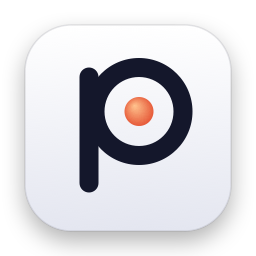

# Protium

Steam Play for Apple Silicon Macs, built natively. Protium is Valve's Proton 11 with its Wine
compiled as an arm64 macOS program, FEX inside Wine for the game's x86 code, and Direct3D drawn on
Metal. Nothing runs under Rosetta and there is no virtual machine: Mac Steam installs the Windows
build of a game and starts it through Protium, the way Steam on Linux starts Proton.

The name: protium is hydrogen-1, the lightest form of the lightest element, one proton and one
electron. It is Proton with nothing added that it does not need: no Rosetta, no virtual machine.
The icon is a letter P whose bowl is the electron's orbit, with the proton at its centre.

Protium is early. Its app installs on any Apple Silicon Mac with macOS 27, but it has been built
and tested on one (an M4 Pro on macOS 27.2).

Protium is not affiliated with or endorsed by Valve or Apple. Steam and Proton are trademarks of
Valve Corporation, and Mac and Metal are trademarks of Apple Inc.

What changed in each release is in [CHANGELOG.md](../CHANGELOG.md).

Protium asks GitHub once a day whether a newer version is out, tells you in its window and with
a short banner over the game when you start one, and can update itself. The request is a plain look at the
list of releases at `api.github.com`, with nothing about your Mac or your games in it. The
checkbox "Tell me about new versions" in Protium's window, or `steamplay updates off`, turns it
off, and then no request is made.

## Status

<!-- games: written by "macos/steamplay games" from macos/compat/games.json -->
| Game | Graphics | Verdict | Notes | Tested |
|---|---|---|---|---|
| Call of Duty: Modern Warfare Remastered (2017) | Direct3D 11 | Works | Plays at 5120x1440 and 60 fps, mouse look even. The first load of a level takes several minutes while shaders compile | 2026-11-24 |
| Call of Duty: World at War | Direct3D 9, 32-bit | Works | Plays well; cutscenes can be skipped | 2026-11-24 |
| IRON NEST: Heavy Turret Simulator | Direct3D 11 and Direct3D 12 | Works | Plays from its Steam library entry, with stats and cloud saves | 2026-11 |
| Just Die Already | Direct3D 11 | Works | Plays from Steam | 2026-11 |
| Left 4 Dead | Direct3D 9, 32-bit | Works | Stats and Steam Cloud work | 2026-11 |
| Call of Duty: WWII | Direct3D 11 | Plays, with problems | Loads a mission, but stutters | 2026-11 |
| Red Dead Redemption 2 | Vulkan | Plays, with problems | Reaches gameplay. Its frame rate is limited by CPU time | 2026-11 |
| GTFO | Direct3D 11 | Starts, not played further | Starts, and its network layer and PlayFab sign-in come up. Matches untested | 2026-11 |
<!-- games end -->

Steam Play itself works on Mac Steam:
- installing the Windows build of a game;
- Play from the game's own library entry;
- a per-game choice between the Mac build and Protium;
- the Steamworks API (sign-in, ownership, stats, achievements);
- Steam Cloud.

Missing so far:
- the Steam overlay;
- OpenGL above 2.1;
- .NET programs (wine-mono) and embedded web views (wine-gecko).

Games with kernel-level anti-cheat are not expected to work.

[macos/PARITY.md](../macos/PARITY.md) compares Protium with Steam Play on Linux, point by point, and
names the check or game behind each.

## How it fits together

| Layer | Component | On macOS |
|---|---|---|
| Windows API | Proton 11's Wine (the `wine` submodule, branch `macos-arm64`) | A native arm64 Mach-O program |
| x86 code | [FEX](https://github.com/FEX-Emu/FEX) | Wine's ARM64EC (x86-64) and WoW64 (32-bit x86) emulator, with hardware TSO while x86 code runs |
| Direct3D 9 | [mtld3d](https://github.com/athei/mtld3d) | Direct to Metal |
| Direct3D 10 and 11 | [DXMT](https://github.com/3Shain/dxmt) | Direct to Metal |
| Direct3D 12 | [vkd3d-proton](https://github.com/HansKristian-Work/vkd3d-proton) | On Vulkan |
| Vulkan | KosmicKrisp, [Mesa](https://mesa3d.org)'s Vulkan driver on Metal 4 | On Metal |
| Steam | Mac Steam's own Steam Play, and Proton's lsteamclient bridged to Mac Steam's client library | Sign-in, ownership, stats, cloud saves |

Protium builds on athei's macOS work: Mesa, DXMT, vkd3d-proton and FEX come from athei's branches
([mesa](https://github.com/athei/mesa), [dxmt](https://github.com/athei/dxmt),
[vkd3d-proton](https://github.com/athei/vkd3d-proton), [FEX](https://github.com/athei/FEX)) at the
commits each build script names, and Direct3D 9 is athei's mtld3d. Protium's own fixes to those
projects are in [macos/patches](../macos/patches), and each one says at its head what it fixes.

## How Protium compares

Several projects run Windows games on Apple Silicon, and most of them run more games than Protium
does today. If you want to play tonight, use one of them. What differs is the stack underneath.
As of November 2026, from each project's own pages:

| Project | What runs the game | The game's x86 code | Steam | Cost |
|---|---|---|---|---|
| **Protium** | Valve's Proton 11, with Wine as a native arm64 program | FEX, inside Wine | Mac Steam's own Steam Play | Free, GPL-3.0 |
| [Hadron](https://github.com/Broyojo/hadron) | Wine as a native arm64 program | FEX, inside Wine | Mac Steam's own Steam Play | Free, open source |
| [CrossOver](https://www.codeweavers.com/crossover) | CodeWeavers' Wine, with Apple's D3DMetal or DXMT | Rosetta 2; a FEX build is in preview | Windows Steam, installed in a bottle | Paid |
| [NotProton](https://github.com/NotProtonNot/NotProton) | Your copy of CrossOver | As CrossOver | Mac Steam's own Steam Play | Free, GPL-3.0; needs CrossOver |
| [Bridgeplay](https://bridgeplay.dev) | CodeWeavers' Wine, with Apple's D3DMetal | Rosetta 2 | Mac Steam's own Steam Play | Free, GPL-3.0 |
| [steamac](https://github.com/fxgl/steamac) | Proton on Valve's ARM64 SteamOS, in a virtual machine | FEX, in the virtual machine | Linux Steam, in the virtual machine | Free, Apache-2.0 |

What Protium sets out to do differently:

- **Valve's Proton tree.** Protium is built from Proton 11's own tree, with its Wine and its
  Steam bridge, not from a separate Wine build. Proton's launcher script is not ported yet: a
  smaller one of Protium's own starts the games.
- **Open graphics layers.** Direct3D goes to Metal through mtld3d, DXMT and vkd3d-proton, not
  through Apple's D3DMetal, so every layer can be read and fixed.
- **Nothing to buy and nothing under Rosetta.** Only the game's own code is translated. Wine, the
  Direct3D layers and the Steam bridge are arm64 code.
- **No code added to Steam.** NotProton made it widely known that Mac Steam contains Steam Play,
  switched off. NotProton's way of switching it on, which Bridgeplay also uses, adds a library to
  the Steam app and signs the app again. Protium writes one line to a configuration file that
  Steam reads itself.

Hadron is the closest relative, with nearly the same parts, and
[mach9](https://github.com/athei/mach9) is athei's own native Wine with Direct3D 9 on Metal.

The price of Protium's choices is maturity: it needs macOS 27, has been played on few Macs, and
many games do not start yet. [Status](#status) is the honest list.

## Install

You need an Apple Silicon Mac with macOS 27.0 or later and Steam for Mac.

1. Download `Protium-<version>.dmg` from the
   [latest release](https://github.com/0xLeathery/protium/releases/latest) and open it.
2. Drag Protium into the Applications folder and open it from there.
3. Quit Steam, then click **Set up Steam** in Protium's window. It asks for an administrator
   password once, to make the folder Steam finds its compatibility tools in, and it fetches Valve's
   Windows client DLLs from Valve's own servers.
4. Start Steam, install a Windows game from your library and press Play.

Protium's window also has **Repair**, **Status** and **Uninstall**. Uninstall takes Protium out of
Steam again; saves in Steam Cloud and the folders in `steamapps/compatdata` stay.

The app is signed with a Developer ID and notarized by Apple.

## Build from source

Protium can also be built on the Mac that runs it. These are the steps, in order.

### 1. What you need

- An Apple Silicon Mac. Only macOS 27 has been tried.
- Xcode with its Metal toolchain, and Homebrew. Each build script names any Homebrew formula
  it is missing.
- A paid Apple Developer Program membership. Windows games are x86 code, and FEX can only run
  them when the Wine loader is signed with the cross-architecture entitlement, which gives
  memory below 4 GB and 4K pages (and hardware TSO, which makes FEX faster).

### 2. A provisioning profile for the loader

In the developer portal (Certificates, Identifiers & Profiles):

1. **Identifiers:** register an App ID for the loader and enable its *Cross-architecture
   Compatibility Framework* capability.
2. **Certificates:** an *Apple Development* certificate (Xcode → Settings → Accounts → Manage
   Certificates → +).
3. **Devices:** register your Mac with its Provisioning UDID (`system_profiler SPHardwareDataType`).
4. **Profiles:** a *macOS App Development* profile for that App ID, your certificate and your Mac.
   Save it as `~/projects/proton-macos-build/signing/loader.provisionprofile`.

`macos/bundle-wine.sh` signs the loader with it and takes the bundle identifier and team from it.

### 3. Downloads

- [llvm-mingw](https://github.com/mstorsjo/llvm-mingw/releases) 20261020, the
  `ucrt-macos-universal` build, unpacked into `~/projects/proton-macos-toolchain/` (or set
  `TOOLCHAIN_DIR`).
- [mtld3d](https://github.com/athei/mtld3d/releases) v0.15.3 (`mtld3d-v0.15.3.tar.xz`) in
  `~/projects/proton-macos-build/third-party/mtld3d/`, for Direct3D 9. The bundle checks its
  SHA-256; without it, Direct3D 9 falls back to Wine's own.
- Valve's Windows `steamclient.dll` and `steamclient64.dll`, from the top folder of a Windows Steam
  install, in `~/Library/Application Support/SteamPlay/steamclient-windows/` (or set
  `WIN_STEAM_DLLS`). Mac Steam does not ship them, and Protium cannot either.

### 4. Build

```sh
git clone --recurse-submodules https://github.com/0xLeathery/protium
cd protium
macos/build-vulkan.sh          # the Vulkan loader
macos/build-gstreamer.sh       # GStreamer, for Media Foundation audio and video
macos/build-wine.sh            # Wine, native arm64 (needs the two above)
macos/build-mesa.sh            # KosmicKrisp
macos/build-fex.sh             # FEX, as Wine's ARM64EC and WoW64 emulator
macos/build-llvm15.sh          # static LLVM 15, for DXMT's shader compiler
macos/build-dxmt.sh            # Direct3D 10 and 11
macos/build-vkd3d-proton.sh    # Direct3D 12
macos/build-steam-bridge.sh    # lsteamclient and the rest of Proton's Steam bridge
macos/bundle-wine.sh           # install everything into one bundle, with mtld3d, and sign the loader
```

Each script documents its inputs, outputs and environment overrides at its head. Builds go to
`~/projects/proton-macos-build` unless `BUILD_ROOT` says otherwise. The checkout itself can live
anywhere.

### 5. Set up Steam

Steam looks for compatibility tools in `/usr/local/share/steam/compatibilitytools.d`. Make that
folder once and give it to your user:

```sh
sudo mkdir -p /usr/local/share/steam/compatibilitytools.d
sudo chown "$USER" /usr/local/share/steam/compatibilitytools.d
```

Then quit Steam and run:

```sh
macos/steamplay setup          # the two tools, Steam's platform switch, a tool for every game
macos/steamplay guard install  # keeps the switch and the tools in place when Steam updates
```

Start Steam, install a Windows game and press Play. `macos/steamplay status` shows the switch, the
tools and each game's choice, and `macos/steamplay` with no arguments lists the other commands.

`macos/tests/check-wave*.sh` are the checks each stage of the port was accepted with.

## Star history

[](https://www.star-history.com/#0xleathery/protium&Date)

## Licenses

Protium's own files (`macos/` and `.github/`) are under the GNU General Public License, version 3
or later ([LICENSE.protium](../LICENSE.protium)): anyone who distributes a changed Protium must
publish their changes under the same license. Fixes are welcome back here as pull requests; see
[CONTRIBUTING.md](CONTRIBUTING.md).

Protium's patches in `macos/patches/<project>/` are under the license of the project they change,
and the `wine` submodule is under Wine's license (LGPL 2.1 or later). Valve's Proton files keep
Valve's license ([LICENSE.proton](../LICENSE.proton)), and every other component keeps its own.
[LICENSE](../LICENSE) has the overview.
